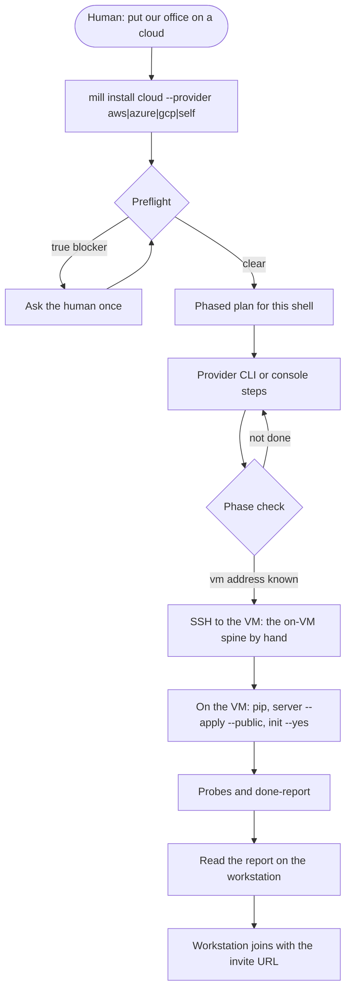

# Cloud host - workstation to one office

Single-tenant: one mill-wall and MySQL 8 (InnoDB) on an Ubuntu LTS VM the operator chooses. Same product as a local host ([HOST.md](HOST.md)). The machine moves. This is not multi-tenant SaaS.

A cold agent (any vendor, new chat) is told "put our office on AWS / Azure / GCP / my own Linux VM". It uses this page, the provider playbook, and `mill install cloud`. It walks a non-expert human through setup, does what it can, and asks only at a true blocker (no account, no payment method, no provider login, no SSH key).

**Status:** not measured OOTB. Card `ootb-cloud-aws-azure-gcp` (#502). A provider stays unmeasured here and in [install requirements S4b](../requirements/install.md) until that provider is measured end to end and a fresh agent, with only the installed pack, reaches the done-report.

## Decisions

1. **Who touches the cloud.** The agent runs the human's own logged-in provider CLI (`aws`, `az`, `gcloud`), or hands the human exact console steps when that CLI is missing. Mill never calls cloud APIs. Mill never stores provider keys in the book, session files, Wall, or the phase-state file.
2. **The door.** Invite is the only public door. Admin access is SSH with key auth, open only to the operator's current public IP in the cloud firewall. No VPN.
3. **The machine.** Ubuntu LTS VM with a public IP. A DNS name is optional. MySQL 8 (InnoDB) on the VM, bound to `127.0.0.1`. Wall HTTPS on 443 with the mill CA ([install requirements A3](../requirements/install.md)). Real TLS on a DNS name is a later add-on. Ubuntu's `mariadb-server` package is not this book.
4. **CLI.** Flags on the existing `mill install cloud`. No new verb.
5. **Teachings.** One cold-agent playbook per provider under [cloud/](cloud/). This page is the phase spine. The printed runbook points at the playbook for the provider it printed.

## Workstation journey



Ask only when the agent cannot proceed: account signup, billing, provider login, registrar, or an SSH key the human must create. Everything else is written here, in the playbook, or done by mill.

### Three ways to run `mill install cloud`

| Where | Command | What it does |
|---|---|---|
| Workstation | `mill install cloud --provider aws\|azure\|gcp\|self` | Preflight, then a phased plan with copy-ready commands for this shell (PowerShell or bash/zsh). A check after each phase. |
| Workstation | SSH to the VM by hand (an `--ssh` option is planned, not in this pack) | On-VM spine over SSH: `python -m pip install the-mill`, `mill install server --apply --public`, `mill init --yes`. Then probes, and read the done-report back. |
| VM | `mill install cloud` | Local probes and the done-report. |

`--public` means the Wall and the mill API are reachable off-box. It never means MySQL is public.

**This pack, this claim:** the command prints the runbook (aws | azure | gcp | self) and runs the local probes. The printed runbook names `docs/install/cloud/<provider>.md`. Preflight, the phased plan, `--ssh`, and writing phase state are the workstation claim. The done-report is still a shape with placeholders until the probe claim fills it from live checks.

### Preflight (workstation)

Before the plan, record pass or fail for: OS, shell (PowerShell, bash, or zsh), Python, SSH client, provider CLI installed and logged in (`aws`, `az`, or `gcloud`; `self` has no provider CLI), and the operator's current public IP. A missing CLI is a console-step path, not a stop, when the playbook has those steps. A missing SSH client, or no public IP when the firewall must allow SSH, is a blocker.

### Phase state

Non-secret resume file: `~/.mill/session/cloud-install.json` (the mill session root; honor the mill home override). A new chat reads it and continues. Fields only:

| Field | Meaning |
|---|---|
| `provider` | `aws`, `azure`, `gcp`, or `self` |
| `region` | Provider region, or empty for `self` |
| `vm` | Public address of the VM (`user` is not stored; SSH user is typed at `--ssh`) |
| `dns` | Optional DNS name, or empty |
| `phase` | Last phase that checked out: `preflight`, `account`, `region`, `network`, `vm`, `address`, `harden`, `install`, `join`, `report` |

Never keys, tokens, account ids, or private keys.

### Phases

Same order in every playbook. Check after each phase before the next.

1. **Account and login** - provider account exists and the CLI is logged in, or the human is in the console.
2. **Region and size** - one region, a small Ubuntu LTS size. Say the rough monthly cost from the playbook.
3. **Network** - VPC / VNet / equivalent, one subnet, firewall: **443** open, **22** from the operator's current public IP only, **3306** closed.
4. **VM** - Ubuntu LTS, SSH key auth, password auth off.
5. **Static IP** - a public IP that survives reboot. DNS is optional.
6. **Harden** - OS updates, SSH key only, root login restricted.
7. **Install** - from the workstation, SSH to the VM and run the on-VM spine: `python -m pip install the-mill`, `mill install server --apply --public`, `mill init --yes` (an `--ssh` option is planned, not in this pack).
8. **Join** - workstation: `mill join --link-file LINKFILE` (the seat welcome link, saved to a file), then `mill connect <desk>`.
9. **Report** - Wall URL, one working invite join line, security checklist from live probes.

Cost and tear-down live in the playbook. Tear-down is how to delete the VM and the public IP so billing stops. It is not a success phase.

## Playbooks

| Provider | Playbook | Status |
|---|---|---|
| AWS | [cloud/aws.md](cloud/aws.md) | unmeasured |
| Azure | [cloud/azure.md](cloud/azure.md) | unmeasured |
| GCP | [cloud/gcp.md](cloud/gcp.md) | unmeasured |
| Any other Linux VM | [cloud/self.md](cloud/self.md) | unmeasured |

`mill install cloud --provider <id>` prints that playbook path. Other provider ids normalize to `self` for the printed runbook. Aliases may still normalize in code. Do not ship twelve installers.

Each playbook starts with `Status: unmeasured`. After a measured end-to-end run, that line becomes `Status: measured <date>, <mill version>`. Commands in a playbook come from that provider's current official docs, shown for PowerShell and for bash.

## On the VM

```
python -m pip install the-mill
mill install server --apply --public
mill init --yes
```

Then plain `mill install cloud` for probes and the done-report. Invite door on, one enabled invite. Desks: [JOIN.md](../JOIN.md).

## Local probe contract

Probes run on the machine where `mill install cloud` is invoked (the VM, or the workstation only for a local signal). They never call a cloud API and never read or store cloud keys.

| Probe id | Result |
|---|---|
| `https_443_intent` | pass when Wall HTTPS is listening on 443 or the wall config intends 443. fail otherwise. |
| `mysql_not_public_bind` | pass when MariaDB/MySQL is bound to loopback (not `0.0.0.0`, `::`, or `*`). fail when the bind is public. skip only when no server config exists yet, with that reason. |
| `ssh_hardened_signal` | pass when readable sshd config has password auth off and root login restricted. skip with a reason when sshd config is not readable (Windows workstation). fail when the file is readable and those settings are open. |
| `door_invite` | pass when the door is invite. fail otherwise on a public host. |

Each probe is **pass**, **fail**, or **skip** with a reason. Any fail blocks a green done-report. Skip does not make a required control green.

The printer in this pack still records a warn/skip snapshot and placeholder Wall and join lines. Treat that as not measured. The probe claim makes the report decide.

## Done-report

The finished report, filled from the live VM (not from this example):

```
Wall: https://<dns-or-ip>/
Join (agent): mill join --office <alias> --link-file LINKFILE (the seat welcome link in a mode-600 file)
Human Wall door: https://<dns-or-ip>/?invite=<KEY>
      bash -c 'mill connect <desk> --vendor <vendor> >/dev/null 2>&1 & trap "kill $!" EXIT; mill inbox'
Security checklist (S3 install requirements):
  [pass|fail|skip] MySQL not public - <probe detail>
  [pass|fail|skip] Wall HTTPS on 443 - <probe detail>
  [pass|fail|skip] SSH locked to the operator IP - <probe detail>
  [pass|fail|skip] Invite door / remote join via invite - <probe detail>
  [pass] No cloud keys in mill book/session/Wall/phase state
  [pass|fail] Join fail-closed if CA missing (where applicable)
```

One invite join line. The workstation runs that join and connects as a desk.

## TLS

Honor existing requirements. Do not add a verb.

- [install requirements S3](../requirements/install.md): mill CA or real TLS; join fail-closed if the CA is missing
- [JOIN.md](../JOIN.md): mill install trusts the office CA on this host. Other devices may warn until they trust `ca.crt`. Do not import `wall.crt`. Real TLS on the public DNS name stays a later JOIN/install line.
- `mill install wall --apply` mints `~/.mill/ssl/ca.crt` and `wall.crt` with openssl. The leaf covers localhost, `wall.local`, loopback, and this host's own address. Set `AGENT_COORD_WALL_IPS` to the public address (comma-separated) so that address is on the certificate too.
- `mill join` fetches that office's `ca.crt` and trusts it for the current user. Windows shows a certificate prompt for `mill-wall-ca`. Accept it, then restart the browser. Do not import `wall.crt`. A different office has a different CA, so each join can prompt once.

## Day-2

After the office is up, update the VM the same way as any other host: [HOST.md](HOST.md#update-a-running-host).

On the VM, from a directory that is not the mill source tree, as the account the wall unit runs as: `pip install -U the-mill`, then `sudo systemctl restart mill-wall`. That does not wipe the book, the CA, or desk tokens. It does not change stored procedures.

New or changed routines are applied on the VM from `agent_coord/server/sql/apply_order.txt`. Skip `wipe.sql` and `tables.sql`. Drop every function, then create them again, including `fn_now.sql`, so the stored names show ALL CAPS functions and lowercase procedures. MySQL stays on loopback. Do not open it to the public address. The full rules and the name check are in [HOST.md](HOST.md#update-a-running-host). Pack and ship stay out of install-cloud scope.

## Book

Default: MySQL 8 on the VM, InnoDB, `bind-address` `127.0.0.1`, same as a local host. A later port to another engine is a separate schema that has been shown to load. Managed DB (RDS, Cloud SQL, Azure Database, and the rest) is a later operator choice. Do not invent a migrate verb.

## Security (cloud adds)

[Install requirements S3](../requirements/install.md). Short: MySQL on loopback; HTTPS on 443 with the mill CA; SSH from the operator's current public IP only; invite-only join; no cloud keys in mill; no VPN-as-door.

## Out of this cut

- Moving an existing office book onto the VM (fresh `mill init` until a documented migrate exists)
- Docker as an installer
- Cloud API code inside mill
- A managed-DB or migrate verb
- A new mill verb
- VPN
- Real TLS on a DNS name (later add-on)
- Marking #502 measured for a provider before the end-to-end measure and the cold-agent test
