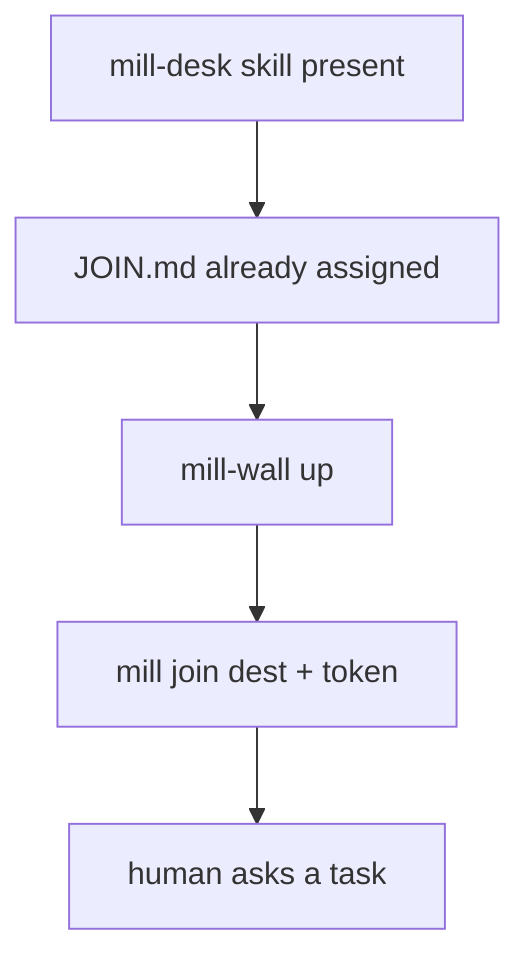
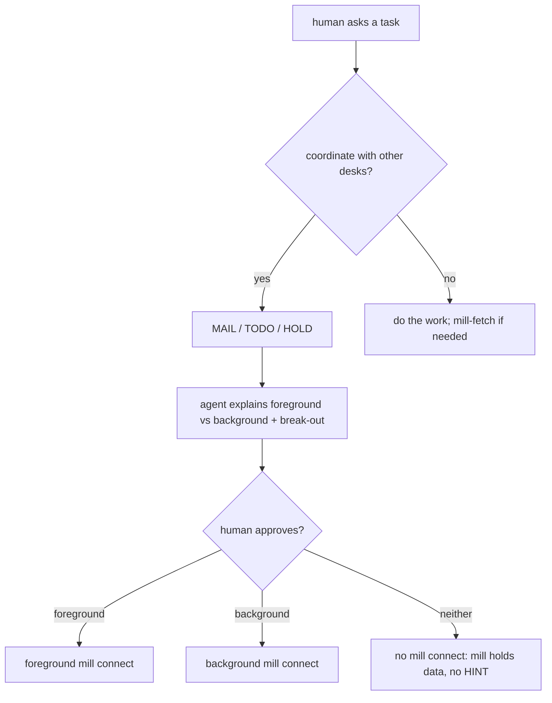
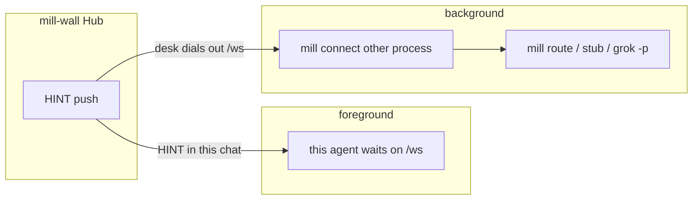
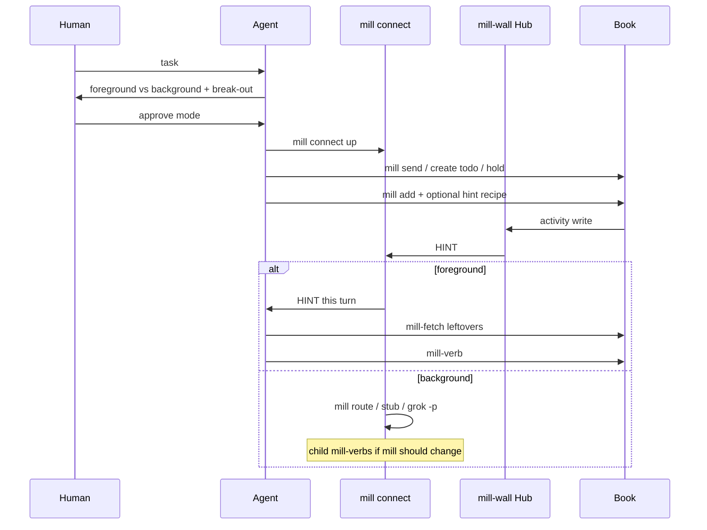

# mill connect - foreground vs background

Pre-T0 docs: mill-desk skill already loaded; **[JOIN.md](../JOIN.md)** already assigned. mill connect modes live here. Chat inbound map: [skill.md](skill.md). HINT `detail`: [hints.md](hints.md). Background program map: [route.md](route.md). Hub `/ws`: [howto-ai.md](howto-ai.md). Grok 1.0.46 foreground mail: [grok-foreground.md](grok-foreground.md).

**Point:** no agent **loops** mill to see if state changed. Watchers push a HINT. mill connect **waits on `/ws`**. mill-fetch **once**. STOP.

Do not say sit. mill connect is **up** or mill connect **died**. Esc does **not** cancel mill connect.

## mill startup (before the human asks)



mill join clocks the dest. mill connect is **not** required yet (until the human's task needs collab HINTs - then background connect on the Wall-reachable host; JOIN.md). No watchers yet -> nothing to miss.

## After the task: explain, then human approves

Foreground vs background is a **work-mode** choice. The agent states **outcomes** (the human need not know `/ws`). Human **approves**. Then mill connect **up**.

**Wakeup paste = approval:** if the human's wakeup paste already includes the `mill connect` line, that paste **is** approval to start **background** connect - do not wait for a second approve.



Coordinate with mill: `mill send` (MAIL), `mill create todo` (TODO), `mill hold` / `mill drop` (HOLD). Tree/label/assign when needed. Not a fourth bus.

## Two modes



| Mode | Who waits on `/ws` | This chat | HINT goes to |
| :--- | :--- | :--- | :--- |
| **Foreground** | **this** agent | **blocked** until HINT handled | this turn (skill.md inbound) |
| **Background** | **another process** | **free** | mill route / stub / `grok -p` |

Same Hub. Same `{type,id,hint,detail}`. `hint` stays `MAIL`/`TODO` (route key). **`detail`** is this desk's `watcher.hint` or the default ([hints.md](hints.md)).

**Today:** background mill connect is the sibling process (route/spawn). **CLI foreground:** mill connect-wait blocks **that** mill process on /ws until **one** work HINT (skips PING) or a non-empty queue (an empty queue keeps waiting; so does one whose items a live connect of this desk already got, outcome `sent`), prints it as JSON, exits - no mill route spawn. Build shells it as this turn, then mill-fetch. Break-out = interrupt that mill CLI (Ctrl+C). Esc still does **not** cancel mill connect. True in-chat inject (HINT turns the TUI without a mill CLI) is still **not** built. mill_wait is a short poll, not this. Do not sell in-TUI foreground until inject exists.

Regression row F28 (connect-wait-holds). Regression row F44 (connect-wait-sent).

Seatless connect: `mill connect NAME` when this computer holds no seat for NAME prints one line on stderr and exits 2, before anything connects: `mill connect: no seat for NAME on this computer; a desk joins once with mill join '<welcome-link>' from the office host (a roster is not a desk: mill connected ROSTER lists its desks)`. The line is the same for a roster, an unknown name and an unjoined desk, and the client asks the office nothing, so the refusal never tells which names exist. Regression row F30 (connect-seatless).

Seat in use: one desk has one live connect; a new `mill connect DESK` takes the seat and the older one exits 5 (superseded). `mill connect -r DESK` (also `connect-wait -r`) refuses instead while another live connect holds the seat: the holder stays, the office closes the newcomer with 4409, and it prints `seat in use (4409): ... plain mill connect DESK (without -r) takes the seat and disconnects the holder` and exits 6. A dead holder does not block it once the office drops that socket; after a drop, an automatic reconnect refused by this desk's own old socket retries for up to 45 seconds, then exits 6 (the first connect never retries). Regression row F43 (connect-refuse).

**Model skill.** Grok Bot cannot leave `mill connect-wait` running. That delta is [models/grok-bot/SKILL.md](models/grok-bot/SKILL.md). Grok Build foreground is [grok-foreground.md](grok-foreground.md). Do not copy this page into a model skill.

## What to tell the human

**Foreground** - I wait on mill. When mail or a card I watch changes, **this chat turns**. Your next line **queues** until I handle that HINT.

**Break out of foreground** (say it before they approve):

- **Force-send** a line - human wins; do not mill-wait as idle. Esc does **not** cancel mill connect.
- **Stop mill connect** - wait ends; dest still joined; **no HINT** until mill connect is **up** again.
- **Switch to background** - mill connect as the other process; this chat is free; HINT does **not** turn this window.

If we cannot break out, **do not recommend foreground**.

**Background** - another mill connect stays **up**. HINT **starts a program** (mill stub, mill route, or `grok -p`). This chat stays free. mill is updated only if that program mill-verbs. This window does **not** auto-turn.

`grok -p` is a **new** process, not a wake of this TUI.

## After approve



1. mill connect **up** (one dest, **one** mill connect; a second is spoof).  
2. `mill add <type>:<id> [--hint ...]` on those MAIL/TODO/HOLD (tree parent if nest).  
3. Background: mill route add, or mill **stub** (HINT JSON in, mill-fetch if needed, **STOP** - no mill-pass because the child exited 0).  
4. HINT -> read `detail` -> mill-fetch only leftovers -> mill-verb -> **STOP**.  
5. Never loop mill inbox/todo to see if state changed.

Switching fg<->bg: **stop** the old mill connect, then start the new mode.

## Constraints

- **One receiver per dest.** Foreground handler **or** mill route spawn, not both on the same HINT.
- **HINT queue.** Drain **one**; human force-send **wins** over a HINT pile.
- **Stub** must STOP. mill connect does **not** mill-update for exit 0.
- **Watchers after** mill connect is **up**. Watching first only fills mill; no doorbell.
- **Background mill connect in this TUI** dies on TUI restart and the 10h job cap. Host mill connect survives.
- **Webhook wake is picked at join, not connect.** `mill connect` configures nothing. See [Webhook wake](#webhook-wake).
- mill route is **not** mill connect. mill route is the background **map** on the mill-connect PC.

## Webhook wake

`mill join` sets how the wall reaches a desk while its connect is down. A plain join leaves websocket delivery (today's default). Webhook delivery:

```
mill join --link-file LINKFILE --webhook-url-file URLFILE --webhook-key-file KEYFILE
mill join <desk> --webhook-url-file URLFILE --webhook-key-file KEYFILE   # a seated desk, no new link
mill join <desk> --websocket                                             # back to websocket only
```

- The key never goes on the command line: `--webhook-key-file PATH`, `--webhook-key-env NAME` or `--webhook-key-stdin`. The key can be copied in any of these forms: the bare key, `Bearer KEY`, or the whole `Authorization: Bearer KEY` line. `--webhook-url URL` also works; `--webhook-url-file` keeps the URL out of shell history.
- A seated desk proves who it is with its own seat token (the one connect presents), so changing its delivery needs no new invite.
- The wall accepts only an https URL on a host in its `wake_hosts` allowlist (host config; default `api2.cursor.sh/automations/webhook/`). It refuses IP literals, a user or password in the URL, a non-default port, and a path with a `.` or `..` segment or an encoded slash, backslash or dot (checked before the prefix, at join and again before every POST). Every address the host resolves to must be public, and a redirect is never followed. A URL off the allowlist is refused with the allowed prefixes and the exact host Admin step to add one: the line `wake_hosts = "CURRENT,HOST/<webhook path prefix>/"` in the wall's config file (`~/.mill/config.toml` of the account mill-wall runs as, or the file named by `AGENT_COORD_CONFIG`), read on the next join with no restart; or, when the wall has `AGENT_COORD_WAKE_HOSTS` set (it wins over the file), that variable in the mill-wall service environment and a restart. The refusal never shows the URL path.
- Join test-fires once (`{"kind": "wake-test"}`) and stores the URL and key only on a 2xx. It prints one line: `{"kind": "wake", "desk": D, "webhook": "armed", "host": H, "test": 200}`. Re-running with the same values prints `"test": "unchanged"` and sends no POST. A failure prints what is wrong and how to fix it, for example the key refused (401), no webhook at that URL (404), host unreachable, wrong host or http. The output never shows the URL path or the key.
- The key belongs to the desk. It is stored on that desk's join row and nowhere else, and only the POST reads it back. No list, wall view, log or error shows it. `mill reset seat` and `mill retire desk` forget it.
- `mill connect` shows the state on its sync line: `"wake": "webhook armed (host H)"` or `"wake": "off"`.

**What a POST is.** The POST is a doorbell for a desk whose connect is down. It carries the same frame a sitting desk would get (`kind`/`type`, `id`, `hint`, `detail`, and the poke key `idem`), plus `desk`, `roster` and a `wake` block (`reason`, `room`, `pending`, `window_s`, `next`). A letter's text is never in it. The desk's own key goes in `Authorization: Bearer` and `X-Automation-Key`.

**Who and why.** `desk` and `roster` name the target, so one receiver can route wakes for many desks. `roster` is the desk's one roster other than Office, else Office (the rule a send uses for its sender roster). `wake.reason` comes from the routing the wall already does: `addressed` for a letter that names this desk (`--to-desk`, `mill add mail:ID`, a roster it is on), a reply to a letter this desk sent, or a card or watch hint; `room` for a reply-all letter this desk gets only as a room participant. When the POST stands for a burst, `reason` is `addressed` if any waiting item is. `wake.room` is the room name of the letter, or null for a hint, an off-room letter, or a thread the wall opened by reply with no room name. The join test POST has `reason` and `room` null. Regression row F73 (wake-route).

Example (placeholder values):

```
{"kind": "mail", "id": 4242, "idem": "mail:4242:DESK", "desk": "DESK", "roster": "ROSTER",
 "wake": {"reason": "room", "room": "ROOM", "pending": 3, "window_s": 120,
          "next": "mill connect DESK: the sync line hands over every waiting hint and letter, and this desk's routes walk them"},
 "mill": "X.Y.Z"}
```

**One POST per window.** After a POST the wall sends no other POST to that desk until the desk connects or `window_s` (120 s) passes. A burst of letters and hints starts one bot run, not one per item. The window starts only when a valid POST is attempted: a URL the wall refuses, or a host that does not resolve to a public address, takes no window, so fixing it (re-arming) wakes the desk at once.

**One log line per wake.** The wall writes one line per desk for every wake on `mill-backchannel.log`, for a letter and a hint alike: `webhook desk=D kind=mail id=N wake=sent status=200` (a hint names `type=` instead of `kind=`), `wake=coalesced reason=window`, `wake=skipped reason=not-allowed` or `reason=not-public`, or `wake=fail status=N` / `wake=fail err=TYPE`. It never shows the URL, its host or the key (the sync line shows the host). A desk that is not armed logs nothing.

**Nothing is lost.** Every hint and letter that went to a webhook desk, whether POSTed or held back by the window, stays in that desk's push queue as `missed`. The woken desk runs `mill connect DESK` and gets every one of them on its sync line. Its redirector chain then walks each one with the same walk and key check a live hint gets ([route.md](route.md)). A route takes a hint it matches. A hint no route takes is left for the agent reading the sync line, with no second vendor poke.

## Doc split

| Doc | When |
| :--- | :--- |
| JOIN.md | mill startup + pointer here |
| **this file** | fg vs bg, explain/approve, break-out |
| skill.md | chat inbound / outbound once they are a dest |
| hints.md | `detail` / `watcher.hint` recipes |
| route.md | HINT -> program |
| access.md | Bearer dest |

`mill briefing connect`

## Windows / PowerShell notes

- Prefer `--doing=text-without-spaces` (or quote carefully). PowerShell `Start-Process -ArgumentList` with `--doing` then a spaced string can split into extra argv; `mill` then rejects unknown tokens.
- Same host rule as JOIN: mill connect must run where Wall is reachable.

