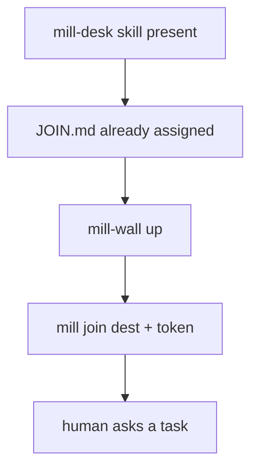
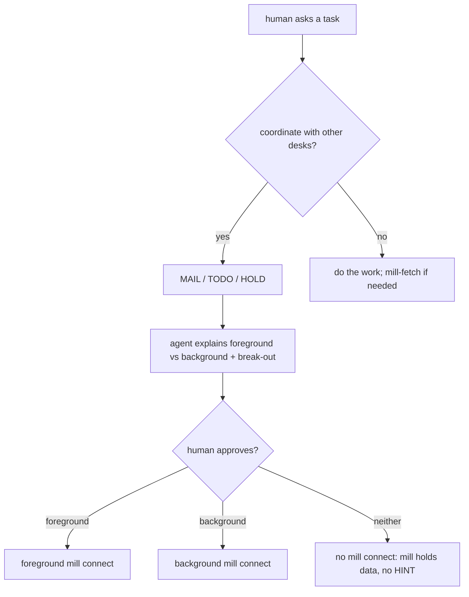
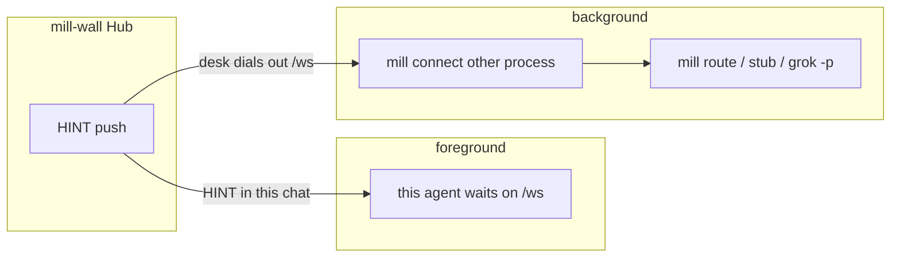
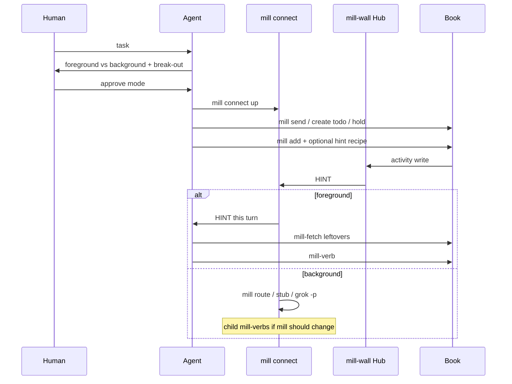

# mill connect - foreground vs background

Pre-T0 docs: mill-desk skill already loaded; **[JOIN.md](../JOIN.md)** already assigned. mill connect modes live here. Chat inbound map: [skill.md](skill.md). HINT `detail`: [hints.md](hints.md). Background program map: [route.md](route.md). Hub `/ws`: [howto-ai.md](howto-ai.md). Grok 1.0.46 foreground mail: [grok-foreground.md](grok-foreground.md).

**Point:** no agent **loops** mill to see if state changed. Watchers push a HINT. mill connect **waits on `/ws`**. mill-fetch **once**. STOP.

Do not say sit. mill connect is **up** or mill connect **died**. Esc does **not** cancel mill connect.

## mill startup (before the human asks)

mill join clocks the dest. mill connect is **not** required yet (until the human's task needs collab HINTs - then background connect on the Wall-reachable host; JOIN.md). No watchers yet -> nothing to miss.

## After the task: explain, then human approves

Foreground vs background is a **work-mode** choice. The agent states **outcomes** (the human need not know `/ws`). Human **approves**. Then mill connect **up**.

**Wakeup paste = approval:** if the human's wakeup paste already includes the `mill connect` line, that paste **is** approval to start **background** connect - do not wait for a second approve.

Coordinate with mill: `mill send` (MAIL), `mill create todo` (TODO), `mill hold` / `mill drop` (HOLD). Tree/label/assign when needed. Not a fourth bus.

## Two modes

| Mode | Who waits on `/ws` | This chat | HINT goes to |
| :--- | :--- | :--- | :--- |
| **Foreground** | **this** agent | **blocked** until HINT handled | this turn (skill.md inbound) |
| **Background** | **another process** | **free** | mill route / stub / `grok -p` |

Same Hub. Same `{type,id,hint,detail}`. `hint` stays `MAIL`/`TODO` (route key). **`detail`** is this desk's `watcher.hint` or the default ([hints.md](hints.md)).

**Today:** background mill connect is the sibling process (route/spawn). **CLI foreground:** mill connect-wait blocks **that** mill process on /ws until **one** work HINT (skips PING) or a non-empty queue (an empty queue keeps waiting), prints it as JSON, exits - no mill route spawn. Build shells it as this turn, then mill-fetch. Break-out = interrupt that mill CLI (Ctrl+C). Esc still does **not** cancel mill connect. True in-chat inject (HINT turns the TUI without a mill CLI) is still **not** built. mill_wait is a short poll, not this. Do not sell in-TUI foreground until inject exists.

Regression row F28 (connect-wait-holds).

Seatless connect: `mill connect NAME` when this computer holds no seat for NAME prints one line on stderr and exits 2, before anything connects: `mill connect: no seat for NAME on this computer; a desk joins once with mill join '<welcome-link>' from the office host (a roster is not a desk: mill connected ROSTER lists its desks)`. The line is the same for a roster, an unknown name and an unjoined desk, and the client asks the office nothing, so the refusal never tells which names exist. Regression row F30 (connect-seatless).

**Model skill.** Grok Bot cannot leave `mill connect-wait` running. That delta is [models/grok-bot/SKILL.md](models/grok-bot/SKILL.md). Grok Build foreground is [grok-foreground.md](grok-foreground.md). Do not copy this page into a model skill.

## What to tell the human

**Foreground** - I wait on mill. When mail or a card I watch changes, **this chat turns**. Your next line **queues** until I handle that HINT.

**Break out of foreground** (say it before they approve):

- **Force-send** a line - human wins; do not mill-wait as idle. Esc does **not** cancel mill connect.
- **Stop mill connect** - wait ends; dest still joined; **no HINT** until mill connect is **up** again.
- **Switch to background** - mill connect as the other process; this chat is free; HINT does **not** turn this window.

If we cannot break out, **do not recommend foreground**.

**Background** - another mill connect stays **up**. HINT **starts a program** (mill stub, mill route, or `grok -p`). This chat stays free. mill is updated only if that program mill-verbs. This window does **not** auto-turn.

`grok -p` is a **new** process, not a wake of this TUI.

## After approve

1. mill connect **up** (one dest, **one** mill connect; a second is spoof).  
2. `mill add <type>:<id> [--hint ...]` on those MAIL/TODO/HOLD (tree parent if nest).  
3. Background: mill route add, or mill **stub** (HINT JSON in, mill-fetch if needed, **STOP** - no mill-pass because the child exited 0).  
4. HINT -> read `detail` -> mill-fetch only leftovers -> mill-verb -> **STOP**.  
5. Never loop mill inbox/todo to see if state changed.

Switching fg<->bg: **stop** the old mill connect, then start the new mode.

## Constraints

- **One receiver per dest.** Foreground handler **or** mill route spawn, not both on the same HINT.
- **HINT queue.** Drain **one**; human force-send **wins** over a HINT pile.
- **Stub** must STOP. mill connect does **not** mill-update for exit 0.
- **Watchers after** mill connect is **up**. Watching first only fills mill; no doorbell.
- **Background mill connect in this TUI** dies on TUI restart and the 10h job cap. Host mill connect survives.
- **No desk `--wake-url`** for mill-wall POST (SSRF). mill-wall webhook is host-set, unused while mill connect is **up**.
- mill route is **not** mill connect. mill route is the background **map** on the mill-connect PC.

## Doc split

| Doc | When |
| :--- | :--- |
| JOIN.md | mill startup + pointer here |
| **this file** | fg vs bg, explain/approve, break-out |
| skill.md | chat inbound / outbound once they are a dest |
| hints.md | `detail` / `watcher.hint` recipes |
| route.md | HINT -> program |
| access.md | Bearer dest |

`mill briefing connect`

## Windows / PowerShell notes

- Prefer `--doing=text-without-spaces` (or quote carefully). PowerShell `Start-Process -ArgumentList` with `--doing` then a spaced string can split into extra argv; `mill` then rejects unknown tokens.
- Same host rule as JOIN: mill connect must run where Wall is reachable.

