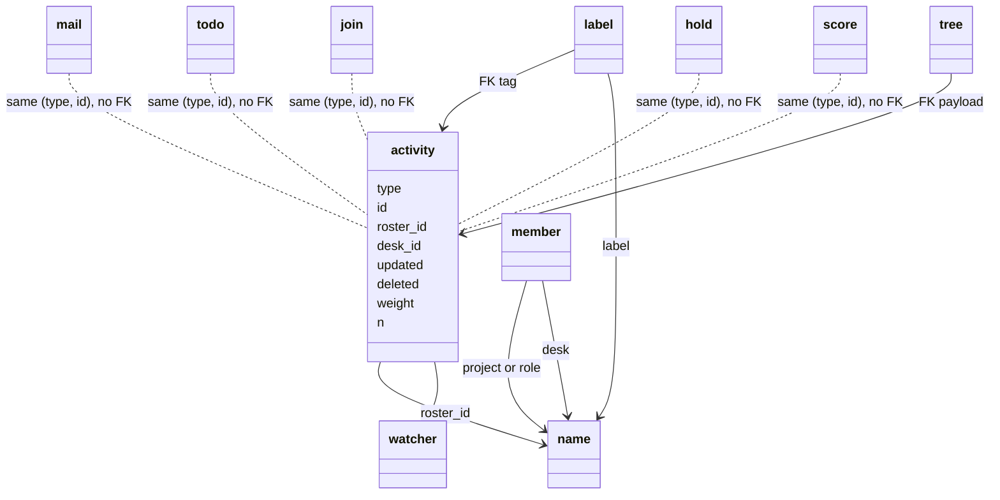

# Records

Tables in `agent_coord/server/sql/tables.sql`. Python: `agent_coord/server/records/` (`CALL mill_*` only).

**Roster** is the one name type for teams. id 1 = Office. id 2 = Admin. CLI argv `ROSTER` is a roster (`the-mill`, Office, ...). SQL/JSON for mail, todo, score, and activity is **`roster_id`**. `` `join` `` has no roster (groups and roles are `member`). Hold has no roster. `name.deleted` retires a name (the unique key stays). Create: desk `mill connect`, roster Admin `mill create roster`. Office host KPIs (`mill-wall.*`, `mill-desk.*` office rows, book KPIs) are score rows with `roster_id` Office and `desk_id` the Admin roster, written by `mill_score_admin_upsert` (no watcher). Admin is never looked up as a desk. Regression row F19 (score-tick-admin-roster). Rename/reclaim: [usecases.md](usecases.md) N1-N4.

`` `join` `` is unique `desk_id` - the hash owns the name, not a pid. `watcher` is who to poke. `mail_to` is who has mail. `member` is who belongs to a group or role. `mill_invite` is door (pending until `enabled_at`).

| table | mill thing |
|---|---|
| `name` | Bare string plus type `desk`, `project`, `role`, `label`, `tree`, or `res`. PK `id`. UNIQUE `(type, name)`. `n` is the desk count for a project or a role. Seeds: `(1, project, Office)`, `(2, role, Admin)`. A name row is not an activity. |
| `activity` | `(type, id)`. Types: `mail`, `todo`, `join`, `hold`, `score`. `roster_id` is required, default 1 (Office). `bytes` is the last payload UTF-8 length (mail or todo body). |
| `mail` | letter (sender `desk_id`, body, `roster_id`). No dest. |
| `mail_to` | dest `desk_id`, `opened`, `receipt`, `asked` (1 named on the letter, 0 copied: reached only as a room member on reply-all; waiting on a desk counts asked rows). No roster column. JOIN `name` for the desk name. Survives mill member-remove. |
| `member` | N-N `(name_id, desk_id)`. `name_id` is a project or a role. Not a label. `name.n` = desk count. |
| `todo` | One JSON `body`. The floor prints `need_id`: the need string the creator passed, kept in that JSON body (`todo.py` reads it back from the `slug` key). **`need_id` is not a name tuple** (not `(type, name)` / not `ROLE_` / `PROJ_` speech). There is no need column. `updated_id` last desk that wrote; `creator_id` mill create todo; `assigned_id` claimer; `roster_id` project or role. |
| `` `join` `` | live seat; unique `desk_id`. Groups and roles are `member`. `doing` VARCHAR(512). Desk bearer is `token_hash`. |
| `human` | one person. They hold the bearer. The book stores `bearer_hash`. `directory_sub` is the directory or IAM subject. |
| `human_desk` | one human, many desks. One desk, one human. |
| `human_member` | directory group mapped onto a mill role. No row means viewer. |
| `hold` | One lock per resource. `resource_id` is a res name. `desk_id` NULL means free. No roster column. Release nulls `desk_id`; the row stays. |
| `score` | The definition of a series: `desk_id`, `roster_id`, `kpi`, `target`, `better` (up or down), `unit`; `value`/`note` hold the latest point. UNIQUE `(roster_id, desk_id, kpi)`. A series recorded with `mill score` is owned by the roster (`desk_id` = roster id). |
| `score_point` | One numeric point of a score: PK `(score_id, id)`, `created`, `desk_id` (who recorded it), `value` DOUBLE, `note`. Newest N is a backward primary-key read. FK `score_id` and `desk_id` ON DELETE RESTRICT. |
| `score_evidence` | History of one score. Hour rows are `1970-01-01` at that clock hour; `taken` is the real day. Day rows are the real midnight. `value` is JSON, at most 4096 bytes. Day rows older than 30 days are removed. The 1970 hour rows stay. FK `score_id` ON DELETE RESTRICT (#95: score delete keeps the card). |
| `tree` | Celko nested set. Structure only. `name_id` is a tree name. Payload is an activity `(type, id)`. The first card is lft 1, rgt 2. PK `(name_id, type, id)`. mill attach/move/prune/detach. |
| `watcher` | who to poke `(type, id, desk_id)`. Types: `todo`, `join`, `hold`, `score`. Not used for mail. `desk_id` is a desk or a roster; a roster row expands to its members at wake time (`mill add`). A name id is not a watcher target. |
| `push_queue` | one async HINT, MAIL, or receipt per desk. Deleted when a mill sync hands it back. Rows older than 30 days are never handed back. `mill_push_expire` deletes them at wall start and then twice a day. Each desk that lost rows gets one `kind=expired` line (window start, window end, and counts for hint, mail, receipt, missed, and error; no bodies). A later window adds to that same line. The line does not age out. |
| `label` | N-N tags `(type, id, name_id)`. `name_id` is a label name. You label activities. |
| `mill_invite` | door keys |
| `mill_invite_join` | who used an invite |

`updated` on `activity` moves. Each new mail, todo, join, hold, and score row inserts its activity row with the id that table just allocated. A name write does not insert an activity row. The write chart is [../requirements/activity.md](../requirements/activity.md).

**`watcher` watches an activity** of type `todo`, `join`, `hold`, or `score`. Hub poke is `{type, id, hint}`. Payload tables (`mail`, `mail_to`, `todo`, ...) are state. Mail does not use `watcher`. A send pushes `{kind: mail}` to each `mail_to` desk. An open with `receipt` set pushes `{kind: receipt}` to the sender. `push_queue` keeps each of those, and each watcher frame, until the next mill sync (`mill connect` or a mill command) hands them back and deletes the row. Doing is `` `join`.doing `` (`mill_join_doing`). Hub rooms are `/ws/<name>`. The name table stores that desk name. Glance seeds are name objects: project `Office` and `Admin`.

Activity is the timeline, not a parent. Each `mail`, `todo`, `join`, `hold`, and `score` row has one activity row with the same `(type, id)`, written in the same transaction after the payload (#216). No payload table has a foreign key to `activity`. Only `label` and `tree` keep one (`fk_label_activity`, `fk_tree_activity`). `score_point` and `score_evidence` hang off `score`. `mail_to`, `human`, `human_desk`, `human_member`, `push_queue`, `mill_invite`, and `mill_invite_join` are in the table above and have no activity row. The chart is [../requirements/activity.md](../requirements/activity.md).

`member` is live roster (desk <-> project or role). `mail_to` is **snapshot at send** (late joiners miss old mail). `label` tags activities. mill attach is tree (put under).

Session token file is `~/.mill/session/<name>.token` (`client/tokens.py`, hash on `` `join` ``), not the `activity` table. `protocol/presence/` is an old mill drain path (ignore).

Tests: `tests/server/records/test_records.py` (DB `mill_records_test`).
