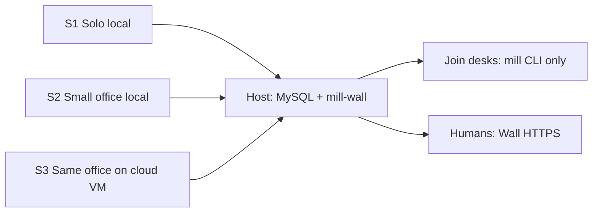
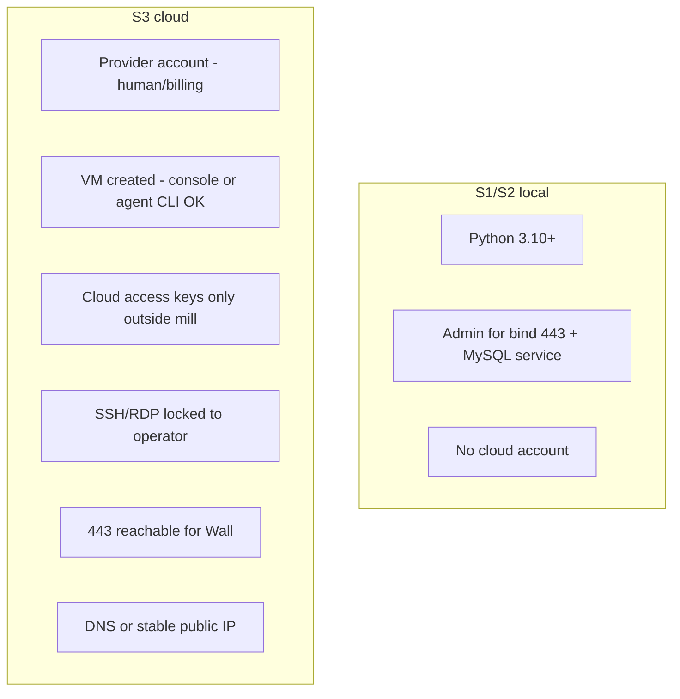

# Install - requirements (host + cloud)

How mill **must** install. Howto: [../install/](../install/). Invite door detail: [invite.md](invite.md). Env/tokens: [env-variables.md](env-variables.md).

Prefer diagrams. Single file on purpose (host + cloud share one bar). Docs here are **product intent**; live host measure wins when they disagree - fix product then docs.

Humans ask **their agent** to install (autonomous or interactive). Agent done-report includes Wall glance URL and join/invite line.

## 1. Scenarios

| Id | Who | Host location | Door default |
|---|---|---|---|
| S1 | One human + many agents | Their PC | LAN / loopback |
| S2 | High-trust small office | Chosen always-on box | LAN; invite for off-LAN |
| S3 | S1/S2 when laptop sleeps / remotes / vendor | Cloud or dedicated VM (AWS/Azure/GCP first; any Linux VM escape hatch) | **Invite** |
| S4 | Office with a company directory or cloud IAM | Same host as S2 or S3 | **directory** or **iam** for the human wall. Agents use the desk bearer. A public host stays **invite** until that door is turned on. |

Multi-tenant SaaS = later (not this doc).

## 2. Preconditions

**Mill must never store** cloud provider access keys in the book, session files, or Wall config.

## 3. Max-security bar (local + cloud)

Applies to **every** host install where the control exists. Cloud adds a harder perimeter; it does not relax local.

| Control | Local | Cloud |
|---|---|---|
| MySQL not on public/0.0.0.0 | required | required (private only) |
| Wall HTTPS only | required | required on 443 |
| `--public` = Wall/API reachability, **not** open DB | careful bind | required meaning |
| SSH/RDP locked | OS hygiene | required |
| Invite vigilance | when off-LAN | **default** (no VPN-as-door) |
| Bearer fail-closed; no forged From | required | required |
| Session tokens in `~/.mill/session/`, not env | required | required |
| mill CA or real TLS; join fail-closed if CA missing | required | required |
| Always-Admin retire/reset; trust-gated assign | required | required |

## 4. OOTB acceptance

### 4a. Local (S1/S2)

| Target | Status |
|---|---|
| Windows host mill-wall service + install check | Measured (see howto) |
| Linux systemd mill-wall + empty-machine bootstrap | **Not yet measured** |
| macOS / WSL host | **Not yet measured** |

Linux local checklist (when measuring): `pip install the-mill` -> `mill install server --apply` -> `mill init --yes` -> Wall `https://127.0.0.1/` (or printed URL) -> desk `mill join` + `mill connect` -> S3 checklist green.

### 4b. Cloud (S3)

Fresh **Linux** VM - deep measure on **each** of AWS, Azure, GCP; other providers use generic Linux VM path:

1. Network/ACL: 443 for Wall; SSH locked; MySQL not public
2. `pip install the-mill`
3. `mill install server --apply --public`
4. `mill init --yes`
5. Wall `https://<dns-or-ip>/` live
6. Remote desk `mill join` (invite) + `mill connect` works
7. Security checklist (S3) green:

- [ ] MySQL not public
- [ ] Wall HTTPS on 443
- [ ] SSH/RDP locked to operator
- [ ] Invite door default / remote join via invite
- [ ] No cloud keys in mill book/session/Wall
- [ ] Join fail-closed if CA missing (where applicable)

`mill install cloud` is one verb. Flags, no new verb ([CLOUD.md](../install/CLOUD.md)):

- `--provider aws|azure|gcp|self` on the workstation: preflight, then a phased plan with copy-ready commands for this shell
- `--ssh <user>@<host>`: on-VM spine over SSH, then read the done-report back
- plain `mill install cloud` on the VM: local probes and the done-report

No cloud API calls. No provider keys in the book, session files, Wall, or phase state (`~/.mill/session/cloud-install.json`: provider, region, vm, dns, phase). Default book = MariaDB on the VM, bound to loopback; managed DB later.

Playbooks: [aws](../install/cloud/aws.md), [azure](../install/cloud/azure.md), [gcp](../install/cloud/gcp.md), [self](../install/cloud/self.md). A provider stays `unmeasured` until that provider is measured end to end and a cold agent reaches the done-report from the installed pack. #502 does not move for a provider before that.

## 5. Out of scope here

- Multi-tenant / mill-as-a-service
- Docker as a second installer (optional wrapper later)
- Documented S1/S2 -> S3 book migrate (TBD; fresh init until then)
- Claiming Linux/cloud OOTB before checklist + VM evidence (#502)
