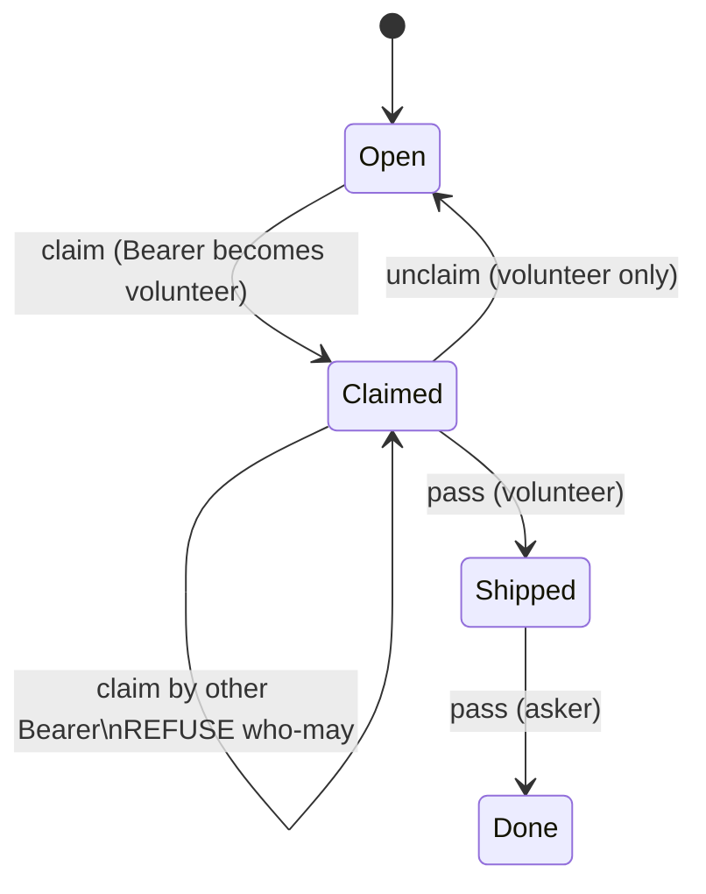

# Todo claim / unclaim - requirements

## Claim who-may (no steal)

Intended: if a card is already `claimed` by desk V, another Bearer must **not** take it with `mill claim`. Ask V to `unclaim` first. `assign` does not overwrite an assignee (incl Admin) - see [admin.md](admin.md).

| Verb | Who may |
|---|---|
| **claim** on `open` | any Bearer desk |
| **claim** on `claimed` (other volunteer) | **refuse** |
| **claim** on `claimed` (self) | idempotent ok |
| **unclaim** | volunteer only |
| **assign** | trust + unassigned only (high: any desk; limited: Admin). Nobody overwrites - assignee unclaims first |

Measured fail-open 2026-09-20: `_h_claim` overwrote mill-prompt-gardener -> build-assist on #73.

Parked fix card: `mill-access-claim-no-steal`.
